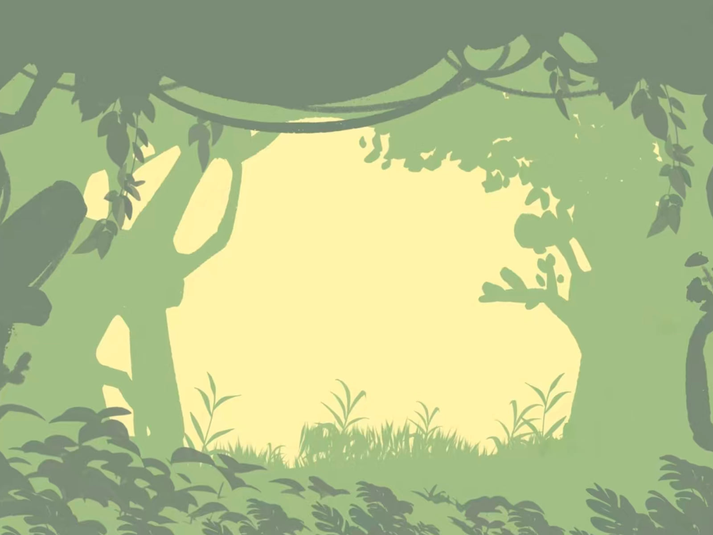

# 躲避游戏

一片森林空地上，子弹从四面八方向你飞来。用 WASD 移动躲开它们，撑过 180 秒就算胜利。

- **作者**：朱栩汕
- **技术**：原生 JavaScript + Canvas 2D（无框架、无依赖）
- **在线试玩**：https://sleepy677.github.io/showcase/projects/dodge-forest/
- **操作**：`W` `A` `S` `D` 移动
- **规则**：初始 3 条命，被击中一次扣 1 条命并清空当前子弹、获得 1.2 秒无敌闪烁；撑满 180 秒通关

## 实现思路

- **子弹追踪**：每 450ms 从画布四条边随机位置生成一颗子弹，速度方向由「子弹位置 → 玩家位置」的向量归一化后乘以 2.5，因此子弹始终朝玩家飞来。
- **碰撞检测**：用圆心距与玩家半宽比较（`dist < bullet.r + player.w/2`），比矩形碰撞更贴合圆形子弹。
- **生命与无敌**：命中后 `lives--`、清空子弹数组、置 `invincible` 1.2 秒，期间玩家以 100ms 间隔闪烁提示。
- **背景适配**：森林图按 `cover` 方式等比缩放居中裁切，不会拉伸变形；图片加载失败时退回草地绿底色，不会白屏。
- **像素角色**：玩家小兵由若干 `fillRect` 拼成（头盔、面罩、护甲、腿、枪），并关掉 `imageSmoothing` 保持像素感；身下垫一层半透明白色，走到深色剪影区域也能看清。

## 文件

| 文件 | 说明 |
| --- | --- |
| `index.html` | 游戏本体（HTML + CSS + JS 全部内联，单个文件即可运行） |
| `forest_bg.jpg` | 森林背景图（1600×1200，与画布同为 4:3） |
