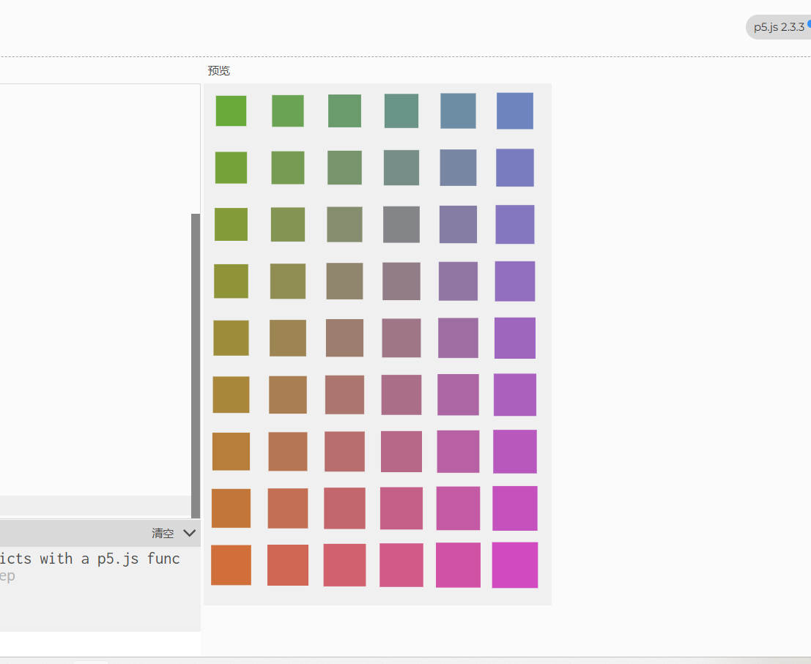

# 几何构成

用 p5.js 生成的程序化几何图形：圆与方块按网格排布，颜色随坐标连续过渡，形成渐变式的构成画面。

- **作者**：朱栩汕
- **技术**：p5.js（canvas 2D）
- **在线预览**：https://sleepy677.github.io/showcase/projects/geometric-composition/
- **运行方式**：打开 `index.html` 即可，无需构建

## 实现思路

在 `sketch.js` 中按 62px 的步长遍历画布网格，用 `map()` 把坐标映射到 RGB 值，得到连续渐变的配色；再根据 `(x + y) / step` 的奇偶性交替绘制圆和方块，形成节奏感。图形尺寸同样随坐标缓慢变化。绘制一次后调用 `noLoop()` 静止。

## 文件

| 文件 | 说明 |
| --- | --- |
| `index.html` | 页面入口 |
| `sketch.js` | 作品逻辑 |
| `style.css` | 页面样式 |
| `p5.js` / `p5.sound.min.js` | p5.js 运行库（本地引入，不依赖 CDN） |
| `朱栩汕-源文件.zip` | 原始源文件打包 |
| `preview.png` | 预览图 |
